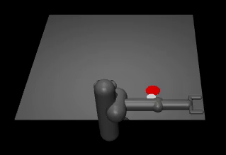
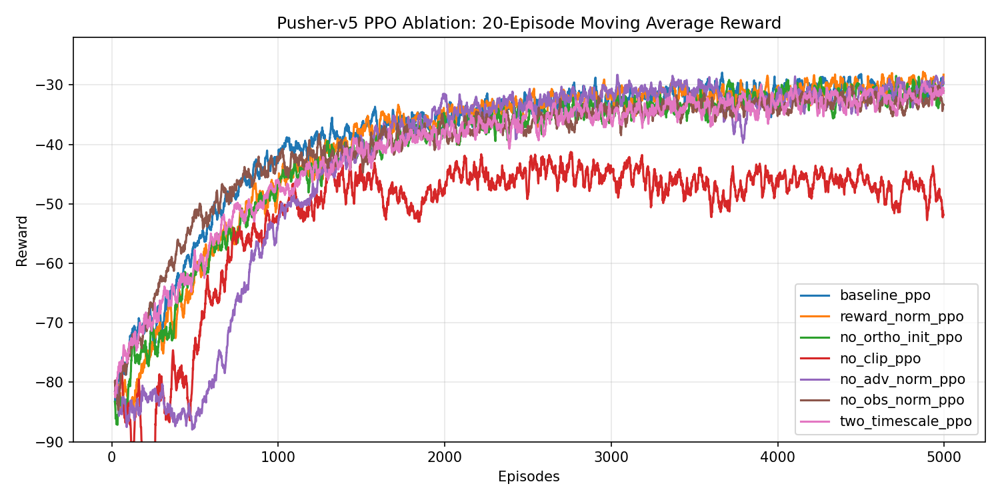
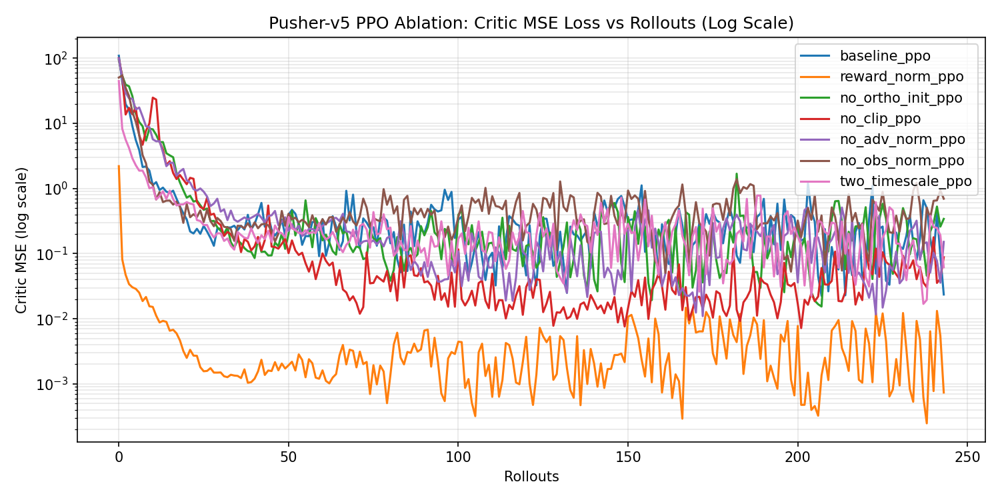

# RL Robotic Arm — Two-Timescale & Normalization PPO Ablations on `Pusher-v5`

**A from-scratch PyTorch implementation and empirical ablation suite evaluating two-timescale stochastic approximation, normalization heuristics, trust-region clipping, and orthogonal initialization for Proximal Policy Optimization (PPO) on the 7-DoF MuJoCo `Pusher-v5` robotic manipulation task.**

<p align="center">
  
  
  
  
  
</p>

<p align="center">
  
</p>

## Table of Contents

- [Overview](#overview)
- [Environment & Dynamics](#environment--dynamics)
- [Ablation Study Design](#ablation-study-design)
- [Mathematical Formulation & Implementation](#mathematical-formulation--implementation)
- [Hyperparameters](#hyperparameters)
- [Results](#results)
- [Installation & Usage](#installation--usage)
- [Project Structure](#project-structure)
- [Created by](#created-by)

## Overview

In continuous-control robotic manipulation, policy gradient stability depends heavily on how quickly the critic tracks shifting state-value targets, how heterogeneous kinematic features and rewards are scaled, and how policy updates are constrained. Rather than treating PPO as a black box, this repository isolates and benchmarks **7 architectural and optimization configurations** from scratch on MuJoCo's `Pusher-v5`:

1. **`baseline_ppo`**: Standard single-timescale Adam updates with running observation normalization, batch advantage standardization, clipped surrogate objective, and orthogonal weight initialization.
2. **`two_timescale_ppo`**: Decoupled polynomial Robbins–Monro step-size schedules forcing the critic to converge on an asymptotically faster timescale than the actor.
3. **`reward_norm_ppo`**: Adds running return-variance scaling to stabilize critic value targets across reaching and pushing phases.
4. **`no_obs_norm_ppo`**: Disables running observation mean/variance standardization to measure sensitivity to unscaled joint angles, velocities, and Cartesian coordinates.
5. **`no_adv_norm_ppo`**: Passes raw Generalized Advantage Estimates (GAE-$\lambda$) directly into the surrogate objective to isolate gradient-scale sensitivity.
6. **`no_clip_ppo`**: Removes the surrogate probability-ratio clipping constraint ($\epsilon \to \infty$) to test trust-region necessity during contact-rich manipulation.
7. **`no_ortho_init_ppo`**: Replaces orthogonal layer initialization with default PyTorch Kaiming/Xavier initialization to evaluate early-exploration conditioning.

## Environment & Dynamics

The experiments run on Gymnasium's [`Pusher-v5`](https://gymnasium.farama.org/environments/mujoco/pusher/) (MuJoCo physics engine), where a 7-DoF robotic arm must reach a cylindrical puck on a tabletop and push it into a target goal disk within a fixed horizon of $T = 100$ steps.

| Component | Dimension / Range | Description |
|-----------|-------------------|-------------|
| **Observation Space** $\mathcal{S}$ | $\mathbb{R}^{23}$ | 7 joint angles, 7 joint angular velocities, 3D fingertip position, 3D cylinder object position, and 3D goal position |
| **Action Space** $\mathcal{A}$ | $[-2.0, 2.0]^7$ | Continuous joint torques applied across shoulder, upper-arm, forearm, and wrist actuators |
| **Reward Function** $R_t$ | $(-\infty, 0]$ | Dense composite reward penalizing fingertip-to-object distance, object-to-goal distance, and squared control effort ($\Vert{}a_t\Vert{}_2^2$) |
| **Termination / Truncation** | $T = 100$ | No early failure termination; episodes truncate strictly at 100 steps, requiring proper value bootstrapping at $s_T$ |

## Ablation Study Design

| Variant | Actor / Critic LR | Obs Norm | Adv Norm | Reward Norm | PPO Clip | Ortho Init | Core Hypothesis Tested |
|---------|-------------------|----------|----------|-------------|----------|------------|------------------------|
| **`baseline_ppo`** | Coupled ($3 \times 10^{-4}$) | On | On | Off | On | On | Reference control performance with standard PPO variance-reduction heuristics |
| **`two_timescale_ppo`** | Decoupled ($\alpha_k / \beta_k \to 0$) | On | On | Off | On | On | Enforcing a faster critic timescale reduces Bellman tracking lag and policy oscillation |
| **`reward_norm_ppo`** | Coupled ($3 \times 10^{-4}$) | On | On | **On** | On | On | Scaling rewards by running return std stabilizes critic MSE and improves goal centering |
| **`no_obs_norm_ppo`** | Coupled ($3 \times 10^{-4}$) | **Off** | On | Off | On | On | Unscaled multi-unit state features degrade MLP gradient conditioning |
| **`no_adv_norm_ppo`** | Coupled ($3 \times 10^{-4}$) | On | **Off** | Off | On | On | Raw advantage variance destabilizes effective step sizes as reward magnitude shifts |
| **`no_clip_ppo`** | Coupled ($3 \times 10^{-4}$) | On | On | Off | **Off** | On | Unconstrained multi-epoch policy gradients cause destructive policy collapse |
| **`no_ortho_init_ppo`** | Coupled ($3 \times 10^{-4}$) | On | On | Off | On | **Off** | Default initialization produces poorly scaled initial action distributions |

### 1. Two-Timescale Stochastic Approximation (`two_timescale_ppo`)
Standard Actor-Critic implementations update policy and value parameters with identical step sizes. Under stochastic approximation theory, asymptotic convergence requires the critic to operate on an asymptotically faster timescale than the actor so that $V_\psi(s)$ closely approximates the true value function $V^{\pi_\theta}(s)$ of the slowly drifting policy. We instantiate separate PyTorch optimizers and `LambdaLR` schedulers governed by Robbins–Monro conditions:

```math
\sum_{k=0}^{\infty} \alpha_k = \sum_{k=0}^{\infty} \beta_k = \infty, \qquad \sum_{k=0}^{\infty} (\alpha_k^2 + \beta_k^2) < \infty, \qquad \lim_{k \to \infty} \frac{\alpha_k}{\beta_k} = 0
```

### 2. Normalization Suite (`reward_norm_ppo`, `no_obs_norm_ppo`, `no_adv_norm_ppo`)
* **Observation Standardization:** `Pusher-v5` concatenates angular positions (rad), angular velocities (rad/s), and Cartesian coordinates (m) into $\mathbb{R}^{23}$. Online Welford statistics $(\mu_t, \sigma_t^2)$ standardize inputs and clip them to $[-10, 10]$.
* **Advantage Standardization:** Standardizing GAE estimates per rollout ($\tilde{A}_t = \frac{\hat{A}_t - \mu_{\hat{A}}}{\sigma_{\hat{A}} + 10^{-8}}$) keeps policy gradient magnitudes invariant across reaching and contact phases.
* **Reward Scaling:** Dividing rewards by the running standard deviation of discounted returns prevents large initial distance penalties from dominating critic MSE gradients.

### 3. Trust-Region Clipping & Initialization (`no_clip_ppo`, `no_ortho_init_ppo`)
* **Surrogate Clipping:** Performing $K = 10$ minibatch passes per rollout without ratio clipping ($\text{clip}(r_t(\theta), 1-\epsilon, 1+\epsilon)$) tests whether GAE and gradient norm clipping alone prevent off-policy divergence.
* **Orthogonal Initialization:** Hidden layers use orthogonal gain $\sqrt{2}$ while the policy output layer uses gain $0.01$ so initial actions remain near zero mean with uniform exploration across all 7 joints.

## Mathematical Formulation & Implementation

### Network Architectures
Both networks are implemented from scratch in PyTorch as separate multi-layer perceptrons:

| Network | Architecture | Output |
|---------|--------------|--------|
| **Actor** $\pi_\theta(a \mid s)$ | `23 → 64 → 64 → 7`, `Tanh` activations | Action mean $\mu_\theta(s)$, paired with a state-independent learnable parameter $\log \sigma \in \mathbb{R}^7$ |
| **Critic** $V_\psi(s)$ | `23 → 64 → 64 → 1`, `Tanh` activations | Scalar state-value estimate $V_\psi(s)$ |

### Core Update Equations
Rollouts of length $N$ are collected using a diagonal Gaussian policy $a_t \sim \mathcal{N}(\mu_\theta(s_t), \text{diag}(\sigma^2))$. Unclipped actions are retained to compute exact log-probabilities $\log \pi_\theta(a_t \mid s_t)$, while clipped copies $\text{clip}(a_t, -2, 2)$ are passed to MuJoCo.

**Generalized Advantage Estimation (GAE-$\lambda$)** with terminal vs. truncation separation:

```math
\delta_t = r_t + \gamma\, V_\psi(s_{t+1})\,(1 - \text{terminated}_t) - V_\psi(s_t)
\qquad
\hat{A}_t = \delta_t + \gamma \lambda\, (1 - \text{done}_t)\, \hat{A}_{t+1}
```

**Clipped Surrogate & Value Objectives** (with probability ratio $r_t(\theta) = \exp(\log \pi_\theta(a_t \mid s_t) - \log \pi_{\theta_{\text{old}}}(a_t \mid s_t))$):

```math
\mathcal{L}^{\text{actor}}(\theta) = -\,\mathbb{E}_t\Big[\min\big(r_t(\theta)\hat{A}_t,\ \text{clip}(r_t(\theta),\, 1-\epsilon,\, 1+\epsilon)\hat{A}_t\big)\Big] \;-\; c_{\text{ent}}\,\mathcal{H}[\pi_\theta(\cdot \mid s_t)]
```

```math
\mathcal{L}^{\text{critic}}(\psi) = \frac{1}{2}\,\mathbb{E}_t\Big[\big(V_\psi(s_t) - (\hat{A}_t + V_{\psi_{\text{old}}}(s_t))\big)^2\Big]
```

## Hyperparameters

| Parameter | Symbol | Value | Description |
|-----------|--------|-------|-------------|
| Discount factor | $\gamma$ | `0.99` | Horizon weighting for long-term pushing rewards |
| GAE parameter | $\lambda$ | `0.95` | Bias–variance trade-off in advantage estimation |
| Clipping threshold | $\epsilon$ | `0.2` | Surrogate trust-region clipping range |
| Base learning rate | $\alpha_0, \beta_0$ | `3e-4` | Initial Adam step size |
| Rollout horizon | $N$ | `2048` | Environment transitions collected per policy update |
| Minibatch size | $B$ | `64` | Samples per stochastic gradient step |
| Update epochs | $K$ | `10` | Optimization passes over each collected rollout |
| Max gradient norm | — | `0.5` | Global L2 gradient clipping threshold |

## Results

### Episodic Return Across Ablations
<p align="center">
  
</p>

### Critic Mean Squared Error (MSE)
<p align="center">
  
</p>

### Evaluation Videos
Recorded `.mp4` policy rollouts across all 7 ablated configurations (3 evaluation episodes per variant) are stored in [`videos/`](videos/).

## Installation & Usage

```bash
git clone [https://github.com/ayushinde22o7/rl_robotic_arm.git](https://github.com/ayushinde22o7/rl_robotic_arm.git)
cd rl_robotic_arm

python -m venv .venv
# Windows: .venv\Scripts\activate    |    Linux/macOS: source .venv/bin/activate

pip install gymnasium[mujoco] torch numpy matplotlib imageio[ffmpeg]
```

Open and run `rl_robotic_arm.ipynb` sequentially to execute all 7 ablation runs, regenerate `pusher_v5_reward_ablation.png` and `pusher_v5_critic_mse_ablation.png`, and export evaluation videos to `videos/`.

## Project Structure

```text
rl_robotic_arm/
├── rl_robotic_arm.ipynb               # Complete PPO implementation, two-timescale schedulers, and 7-variant ablation runner
├── pusher_demo.gif                    # Auto-looping hero evaluation rollout (reward_norm_ppo)
├── pusher_v5_reward_ablation.png      # Episodic return curves across all 7 ablation configurations
├── pusher_v5_critic_mse_ablation.png  # Critic value-function MSE progression across updates
├── videos/                            # Recorded .mp4 evaluation rollouts for all 7 ablation variants
└── README.md
```

## Created by

* **Ayush Shinde**
